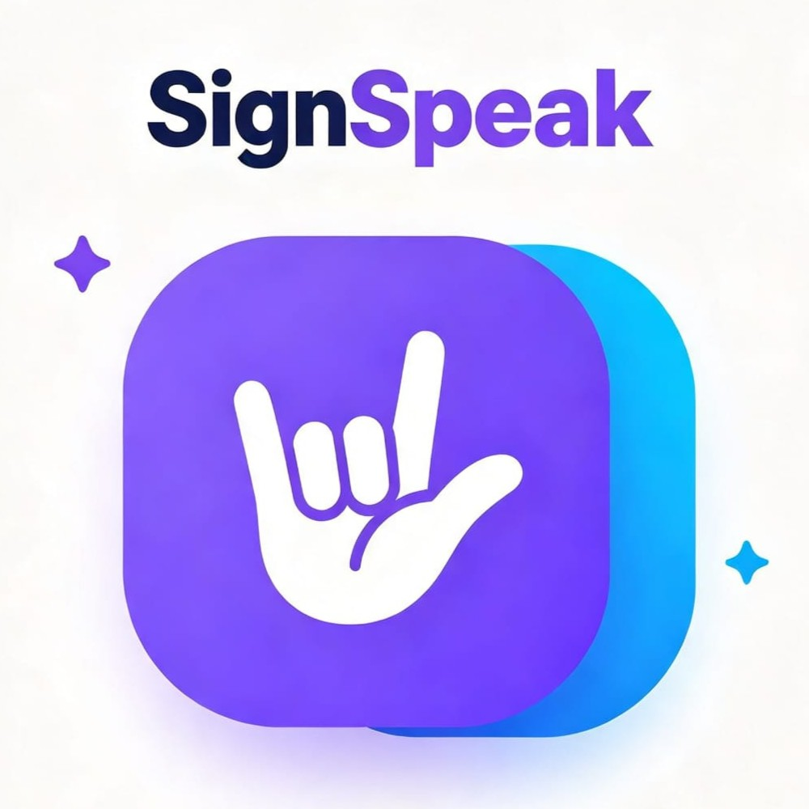

<p align="center">
  
</p>

<h1 align="center">SignSpeak</h1>

<p align="center"><em>Traductor de Lengua de Señas Mexicana (LSM) a texto y voz con un guante sensorial e inteligencia artificial</em></p>

## 📖 Descripción

SignSpeak es una aplicación web progresiva (PWA) diseñada para traducir la Lengua de Señas Mexicana (LSM) a texto y voz en tiempo real, utilizando un guante sensorial con sensores flexibles e inerciales, y un modelo de inteligencia artificial que se ejecuta directamente en el dispositivo móvil.

El proyecto busca reducir la barrera comunicativa entre las personas con discapacidad auditiva y la población oyente que desconoce la LSM, ofreciendo una alternativa portátil, económica y precisa que fomente la autonomía e inclusión del usuario.

## ✨ Características

### 🧤 Guante sensorial

Dispositivo vestible con cinco sensores flexores y un módulo inercial MPU-6050, gestionados por un microcontrolador ESP32.

-   Lectura de flexión de cada dedo
-   Medición de aceleración y velocidad angular
-   Transmisión inalámbrica por Bluetooth de baja energía (BLE) integrado en el ESP32
-   Alimentación autónoma con batería LiPo recargable (TP4056 + MT3608)

### 🤖 Inteligencia artificial

Modelo de red neuronal LSTM entrenado con 15 señas básicas de la LSM, ejecutado localmente en el teléfono con TensorFlow.js.

-   Clasificación de 15 señas de uso cotidiano más la clase "Reposo"
-   Precisión objetivo: más del 85%
-   Ejecución sin conexión (sin servidor)
-   Ventana deslizante de 50 muestras × 11 canales para detección en tiempo real

### 📱 Aplicación web progresiva (PWA)

-   Conexión real con el guante mediante Web Bluetooth
-   Traducción de señas a texto y voz (es-MX), con ajustes de velocidad, tono, volumen y voz
-   Biblioteca visual de dactilología LSM (A-Z) y de las 15 señas, con soporte para video y GIF
-   Historial de traducciones y de señas detectadas, guardado en el teléfono
-   Diagnóstico en vivo del guante: sensores, calidad del enlace y calibración
-   Grabador de dataset con exportación a CSV
-   Modo oscuro
-   Funciona sin internet una vez instalada

### 🎥 Pantallas de la app

-   **Inicio**: estado del guante, última seña detectada y letra del día
-   **Guante**: métricas en vivo, calibración, reconocimiento y grabador de dataset
-   **Traducir**: conversión de texto a secuencia visual de dactilología
-   **Letras**: abecedario completo y 15 señas básicas
-   **Ajustes**: apariencia, voz, reconocimiento y datos guardados

## 🏋 Señas disponibles

| Seña      | Icono | Seña    | Icono |
| --------- | ----- | ------- | ----- |
| Hola      | 👋    | Agua    | 💧    |
| Gracias   | 🙏    | Comida  | 🍎    |
| Por favor | 🤲    | Baño    | 🚻    |
| Sí        | 👍    | Ayuda   | 🆘    |
| No        | 👎    | Amigo   | 🤝    |
| Bien      | 👌    | Familia | 👨‍👩‍👧 |
| Mal       | 👎    | Amor    | ❤️    |
| Casa      | 🏠    |         |       |

> La arquitectura permite incorporar nuevas señas de forma sencilla y escalable.

## 🛠 Tecnologías utilizadas

### Frontend

-   React 19
-   TypeScript
-   Vite
-   CSS3
-   vite-plugin-pwa (Workbox)

### Inteligencia artificial

-   TensorFlow / Keras (entrenamiento)
-   TensorFlow.js (inferencia en el navegador)

### Hardware

-   ESP32 DevKit con Bluetooth de baja energía integrado
-   Cinco sensores flexores
-   MPU-6050 (acelerómetro + giroscopio)
-   Batería LiPo 3.7 V, módulo TP4056 y convertidor MT3608

### APIs del navegador

-   Web Bluetooth API
-   Web Speech API (síntesis de voz)
-   Blob / URL.createObjectURL (exportación de CSV)
-   localStorage (persistencia)

### Control de versiones

-   Git, GitHub y GitHub Pages

## 📂 Estructura del proyecto

```text
signspeak/
├── public/
│   ├── letras/              Imágenes del abecedario (A-Z, LL, RR, Ñ)
│   ├── model/               Modelo de IA (model.json, *.bin, meta.json)
│   ├── videos/              Videos o GIF de las 15 señas (opcional)
│   ├── favicon.svg
│   ├── icons.svg
│   ├── logo.png
│   ├── pwa-192x192.png
│   └── pwa-512x512.png
├── src/
│   ├── components/          Componentes de interfaz
│   ├── hooks/               useGlove, useSettings, useSignMedia
│   ├── lib/                 BLE, clasificador, buffer, CSV, almacenamiento
│   ├── App.tsx
│   ├── App.css
│   ├── glove.css
│   ├── theme.css            Modo oscuro
│   ├── index.css
│   └── main.tsx
├── index.html
├── package.json
├── vite.config.ts
└── README.md
```

## 🚀 Puesta en marcha

```bash
npm install
npm run dev        # desarrollo
npm run build      # compilación de producción
npm run deploy     # publica en GitHub Pages
```

Web Bluetooth solo funciona en **Chrome para Android** y en páginas servidas por HTTPS (GitHub Pages cumple este requisito).

## 🔌 Protocolo del guante (BLE)

El guante expone un servicio GATT con una característica NOTIFY. Cada notificación es una trama de 25 bytes (little-endian):

| Bytes | Contenido |
| ----- | --------- |
| 0 | Encabezado `0xAA` |
| 1 | Contador de secuencia (uint8) |
| 2-11 | 5 flexores (int16, ADC de 12 bits) |
| 12-17 | Acelerómetro (3 × int16, ±2 g) |
| 18-23 | Giroscopio (3 × int16, ±250 °/s) |
| 24 | XOR de los bytes 1 a 23 |

El nombre del dispositivo debe comenzar con `SignSpeak`. Los UUID están definidos en `src/lib/ble.ts`.

## 🧠 Actualizar el modelo de IA

Para actualizar el modelo solo hay que reemplazar los archivos de `public/model/`:

-   `model.json` y los `*.bin`: exportados desde Keras con `tensorflowjs_converter` (formato de capas).
-   `meta.json`: orden de las clases (`labels`), tamaño de ventana (`windowSize`) y, opcionalmente, `mean` y `std` de los 11 canales.

El modelo recibe ventanas de 50 × 11: cinco flexores calibrados (0 a 1), tres ejes de aceleración en g y tres ejes de giroscopio en °/s divididos entre 250.

## 🔴 Grabar un dataset

En la pantalla **Guante**, con el guante conectado y calibrado:

1.  Elige la seña (o "Reposo") y escribe un identificador anónimo de participante, por ejemplo `P01`.
2.  Toca **Grabar**. Tras una cuenta regresiva de 3 segundos se capturan 50 muestras (≈1 s).
3.  Repite las veces necesarias: las grabaciones se acumulan en memoria.
4.  Toca **Descargar CSV** para guardar todas en un solo archivo.

Cada fila del CSV es una muestra, con las columnas `recording, participant, label, t, thumb, index, middle, ring, pinky, acc_x, acc_y, acc_z, gyro_x, gyro_y, gyro_z`. El valor de `recording` identifica cada ventana, lo que permite separarlas al entrenar sin mezclar muestras de una misma repetición. Los valores ya están en la escala de entrada del modelo.

> Las grabaciones no se guardan en el teléfono: descarga el CSV antes de cerrar la app.

## 🎬 Videos y GIF de las señas

Para que la biblioteca de **15 Señas** muestre video en lugar de emoji, coloca los archivos en `public/videos/` con el nombre de la seña en minúsculas, sin acentos y con guion bajo en lugar de espacios. Se prueba primero `.mp4` y luego `.gif`; si no existe ninguno, se usa el emoji.

| Seña | Archivo |
| ---- | ------- |
| Hola | `hola.mp4` |
| Por favor | `por_favor.mp4` |
| Sí | `si.mp4` |
| Baño | `bano.mp4` |

Los archivos se precachean para funcionar sin internet, por lo que conviene mantenerlos cortos y ligeros.

## 🎯 Objetivo del proyecto

Desarrollar un prototipo funcional de un guante sensorial que interprete vocabulario básico de la LSM y lo traduzca a texto y audio en un dispositivo móvil utilizando un modelo de inteligencia artificial, logrando una precisión superior al 85%.

### Objetivos específicos

1.  Diseñar e integrar el circuito electrónico del guante con sensores flexibles y MPU-6050.
2.  Desarrollar el firmware del microcontrolador para lectura, filtrado y transmisión inalámbrica.
3.  Crear una aplicación móvil (PWA) para Android con interfaz accesible.
4.  Recopilar un dataset validado con al menos 15 señas básicas de LSM.
5.  Entrenar y evaluar un modelo LSTM optimizado para ejecución local en el teléfono.

## 📊 Alcances y limitaciones

### Alcances

-   Traducción de 15 señas básicas de LSM (ejecución aislada)
-   Comunicación en un solo sentido: LSM → texto/voz
-   Prototipo funcional validado en entorno controlado
-   Aplicación solo para Android (PWA)
-   Precisión objetivo: >85%

### Limitaciones

-   Vocabulario reducido (15 señas)
-   Solo captura movimientos de una mano
-   Sin información de separación entre dedos ni orientación absoluta
-   Dataset con número reducido de participantes
-   Bluetooth BLE con alcance corto y sensible a interferencias

## 👨‍💻 Equipo de desarrollo

| Nombre                       | Matrícula |
| ---------------------------- | --------- |
| Celis García Leonardo Miguel | 23200818  |
| Estrada Flores César         | 23200832  |
| Gómez Orta Enrique           | 23200842  |
| Fernández Emilio Sebastián   | 23200835  |
| Martínez Martínez Andy Gael  | 23200863  |
| Vidal Delgado Fernando       | 23200905  |

**Grupo:** A  
**Asignatura:** Taller de Investigación II  
**Docente:** Luis Mendoza Austria  
**Institución:** Tecnológico Nacional de México Campus Pachuca

## 📚 Referencias

-   Bangor, A., Kortum, P. T., & Miller, J. T. (2008). An empirical evaluation of the System Usability Scale. *International Journal of Human-Computer Interaction*, 24(6), 574-594.
-   Brooke, J. (1996). SUS: A "quick and dirty" usability scale. In *Usability evaluation in industry* (pp. 189-194). Taylor & Francis.
-   Hochreiter, S., & Schmidhuber, J. (1997). Long short-term memory. *Neural Computation*, 9(8), 1735-1780.
-   INEGI. (2021). *Estadísticas a propósito del Día Internacional de las Personas con Discapacidad*.
-   Lee, B. G., & Lee, S. M. (2018). Smart wearable hand device for sign language interpretation system with sensors fusion. *IEEE Sensors Journal*, 18(3), 1224-1232.
-   Saggio, G., Riillo, F., Sbernini, L., & Quitadamo, L. R. (2016). Resistive flex sensors: A survey. *Smart Materials and Structures*, 25(1), 013001.
-   Zhou, Z., et al. (2020). Sign-to-speech translation using machine-learning-assisted stretchable sensor arrays. *Nature Electronics*, 3(9), 571-578.

> "La comunicación no tiene barreras cuando la tecnología habla por nosotros."

© 2026 SignSpeak • Traductor de Lengua de Señas Mexicana con IA  
Desarrollado con pasión por el equipo de Taller de Investigación II

## 🕘 Historial de Versiones

### V3.0 (Actual) — Release Candidate

-   Modo oscuro con preferencia guardada en el dispositivo.
-   Grabador de dataset con acumulación de grabaciones y exportación a CSV.
-   Soporte de video y GIF en la biblioteca de señas, con respaldo a emoji.
-   Pulido de la interfaz y limpieza general del código.

### V2.0

-   Integración de Web Bluetooth con el guante.
-   Reconocimiento con TensorFlow.js en el dispositivo.
-   Pantalla de diagnóstico del guante.
-   Persistencia de datos (historial, ajustes y calibración).

### V1.0

-   Prototipo inicial.
-   Interfaz de usuario y navegación básica.
